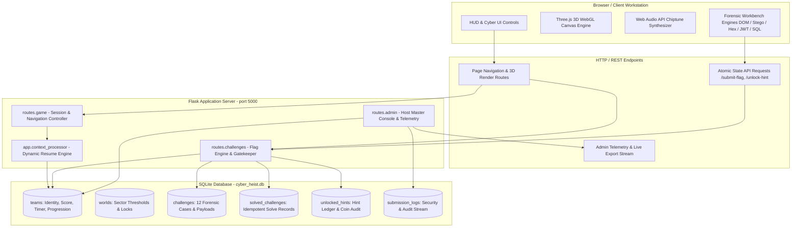
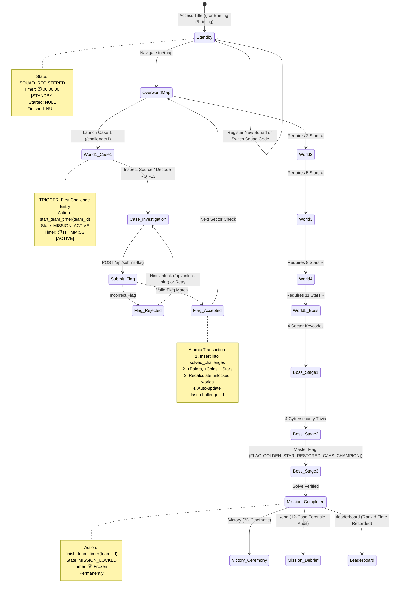
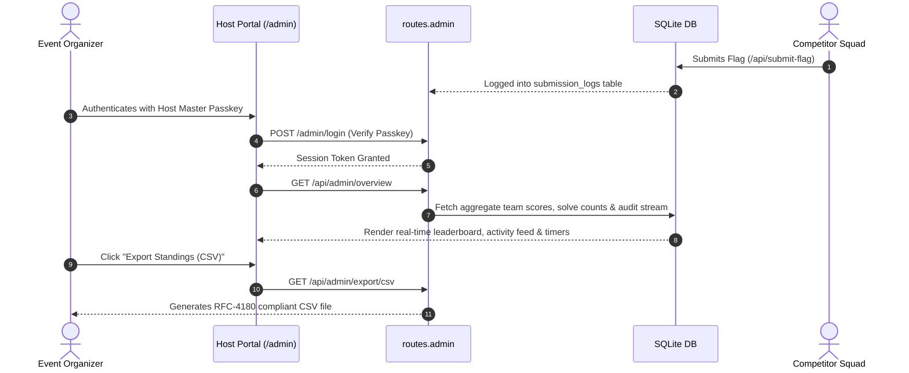

# 🍄 MARIO: THE CYBER HEIST — PROFESSIONAL SYSTEM FLOW & TECHNICAL ARCHITECTURE
**Event:** Chanakya University • OJAS Tech Fest 2026  
**Document Type:** Full Game System Flow, Architectural Blueprint & State Machine Specification  
**Target Audience:** Software Engineers, System Architects, Event Hosts, CTF Platform Developers  

---

## 🏛️ 1. High-Level Architectural Topology

The platform operates as a high-performance, client-server hybrid CTF application designed for LAN tech fests. It combines server-side authoritative state management (Python/Flask + SQLite) with an immersive, hardware-accelerated 3D client layer (Three.js WebGL + Web Audio API).



---

## 🔄 2. End-to-End Player Lifecycle State Machine

The player's journey is governed by a strict, server-enforced state machine ensuring fairness, session persistence, and crash recovery.



---

## ⏱️ 3. Precision CTF Timer Architecture

Unlike simple client-side JavaScript timers that reset on browser reload or cheat easily, the platform implements a **Hybrid Server-Authoritative Timer Engine**:

| Phase | Display Badge | Trigger Condition | Persistence Method |
| :--- | :--- | :--- | :--- |
| **Phase 1: STANDBY** | `⏱️ 00:00:00 [READY]` | Team registration, Briefing, World Map navigation before any challenge is opened. | `teams.started_at IS NULL` |
| **Phase 2: ACTIVE** | `⏱️ HH:MM:SS [ACTIVE]` | Player clicks into World 1 Case 1 (`/challenge/1`) or Case 2. | Server sets `started_at = NOW()`. Client calculates delta: `(Date.now() - started_at_ms)`. |
| **Phase 3: LOCKED** | `🏆 HH:MM:SS [COMPLETED]` | Final Boss (Case 12) defeated or team reaches 12 stars. | Server writes `finished_at = NOW()` and `total_time = HH:MM:SS`. Freezes client ticker permanently. |

### Crash & Reload Resiliency:
- If a browser crashes, the tab is refreshed, or the squad moves to a different PC, logging in with their squad `access_code` instantly recovers `started_at` from SQLite.
- The top HUD calculates the exact elapsed time without losing a single second.
- `app.context_processor` automatically detects where the squad left off and offers **[ RESUME INVESTIGATION ]** or auto-redirects from `/` to their active case.

---

## 🔒 4. Server-Side Security & Anti-Cheat Protocols

1. **Gatekeeping (World Star Thresholds):**
   - Direct URL tampering (e.g., trying to access `/challenge/11` or `/challenge/12` immediately) triggers server-side validation in `routes/challenges.py`.
   - If `team['stars'] < required_stars`, the server renders `locked.html` and blocks challenge payloads.
2. **Idempotent Solve Ledger:**
   - Database enforces `UNIQUE(team_id, challenge_id)` on `solved_challenges`.
   - Resubmitting a previously solved flag returns `already_solved: true` without awarding duplicate points, coins, or stars.
3. **Coin Economy Protection:**
   - Unlocking hints requires an atomic transaction checking `coins >= hint_cost` (25, 50, or 75 coins).
   - Once unlocked, hint contents are stored in `unlocked_hints` so re-viewing hints never charges the squad twice.
4. **Boss Stage Isolation & Anti-Skip:**
   - `/victory` route checks `stars >= 12` or `finished_at IS NOT NULL`. Unauthorized requests are redirected back to `/map`.
5. **Separation of Privileges:**
   - Admin routes (`/admin`, `/api/admin/*`) require server-side session authentication validated against 3 hardcoded host passkeys (`OJAS-HOST-ALPHA-7701`, `OJAS-HOST-BRAVO-9924`, `OJAS-HOST-SUPER-4418`).
   - Host keys are never exposed in player HTML templates or client JavaScript files.

---

## 🗄️ 5. Database Schema & Relational Flow

```
┌──────────────────────────────────────┐       ┌─────────────────────────────────────┐
│                TEAMS                 │       │               WORLDS                │
├──────────────────────────────────────┤       ├─────────────────────────────────────┤
│ id (PK, INTEGER)                     │       │ id (PK, INTEGER)                    │
│ team_name (TEXT, UNIQUE)             │       │ name (TEXT)                         │
│ access_code (TEXT, UNIQUE)           │       │ slug (TEXT)                         │
│ score (INTEGER)                      │       │ description (TEXT)                  │
│ coins (INTEGER)                      │       │ required_stars (INTEGER)            │
│ stars (INTEGER)                      │       │ icon (TEXT)                         │
│ current_world (INTEGER)              │       │ order_index (INTEGER)               │
│ last_challenge_id (INTEGER)          │       └──────────────────┬──────────────────┘
│ started_at (TEXT)                    │                          │ 1:N
│ finished_at (TEXT)                   │                          ▼
│ total_time (TEXT)                    │       ┌─────────────────────────────────────┐
│ last_active (TEXT)                   │       │             CHALLENGES              │
└──────────────┬───────────────────────┘       ├─────────────────────────────────────┤
               │                               │ id (PK, INTEGER)                    │
               │ 1:N                           │ world_id (FK -> worlds.id)          │
               ├──────────────────────┐        │ title (TEXT)                        │
               ▼                      ▼        │ slug (TEXT)                         │
┌──────────────────────────┐ ┌──────────────────────┐ difficulty (TEXT)              │
│    SOLVED_CHALLENGES     │ │    UNLOCKED_HINTS    │ points (INTEGER)                │
├──────────────────────────┤ ├──────────────────────┤ coins_reward (INTEGER)          │
│ id (PK, INTEGER)         │ │ id (PK, INTEGER)     │ star_reward (INTEGER)           │
│ team_id (FK -> teams.id) │ │ team_id (FK)         │ flag (TEXT)                     │
│ challenge_id (FK)        │ │ challenge_id (FK)    │ interactive_type (TEXT)         │
│ solved_at (TEXT)         │ │ hint_number (INTEGER)│ hint1 / hint2 / hint3 (TEXT)    │
│ points_awarded (INTEGER) │ │ unlocked_at (TEXT)   └──────────────────┬──────────────┘
└──────────────────────────┘ └──────────────────────┘                  │
               │                                                       │
               └───────────────────────┬───────────────────────────────┘
                                       ▼
                       ┌───────────────────────────────┐
                       │        SUBMISSION_LOGS        │
                       ├───────────────────────────────┤
                       │ id (PK, INTEGER)              │
                       │ team_id (FK -> teams.id)      │
                       │ challenge_id (FK)             │
                       │ submitted_flag (TEXT)         │
                       │ is_correct (BOOLEAN)          │
                       │ ip_address (TEXT)             │
                       │ submitted_at (TEXT)           │
                       └───────────────────────────────┘
```

---

## 📊 6. Master Challenge Progression Matrix

| World | Sector Name | Case # | Case Title | Technical Category | Reward | Unlock Req |
| :---: | :--- | :---: | :--- | :--- | :--- | :---: |
| **W1** | Mushroom Village | **01** | The Broken Notice Board | Web Forensics (DOM) | 100 PTS / 50 🪙 / 1 ⭐ | 0 ⭐ |
| **W1** | Mushroom Village | **02** | The Suspicious Intercept | Cryptography (ROT-13) | 150 PTS / 75 🪙 / 1 ⭐ | 0 ⭐ |
| **W2** | Dark Forest | **03** | Deep Glitch in the Pines | Steganography (LSB Bitplane) | 200 PTS / 100 🪙 / 1 ⭐ | 2 ⭐ |
| **W2** | Dark Forest | **04** | The Shadow Metadata Trail | OSINT & Forensics (EXIF) | 200 PTS / 100 🪙 / 1 ⭐ | 2 ⭐ |
| **W2** | Dark Forest | **05** | Corrupted Proxy Stream | Network Forensics (Hex) | 250 PTS / 125 🪙 / 1 ⭐ | 2 ⭐ |
| **W3** | Haunted Mansion | **06** | Phantom Directory Traversal | Web Security (Path Traversal) | 250 PTS / 125 🪙 / 1 ⭐ | 5 ⭐ |
| **W3** | Haunted Mansion | **07** | Boo's Vault IDOR Manipulation | API Security (IDOR Bypass) | 300 PTS / 150 🪙 / 1 ⭐ | 5 ⭐ |
| **W3** | Haunted Mansion | **08** | Poltergeist Session Forgery | Auth Exploitation (JWT None) | 300 PTS / 150 🪙 / 1 ⭐ | 5 ⭐ |
| **W4** | Koopa HQ | **09** | The Framed Shellshock | Incident Recon (Reverse Shell) | 350 PTS / 175 🪙 / 1 ⭐ | 8 ⭐ |
| **W4** | Koopa HQ | **10** | Correlated SIEM Logs | Threat Hunting (SIEM Analysis) | 350 PTS / 175 🪙 / 1 ⭐ | 8 ⭐ |
| **W4** | Koopa HQ | **11** | Koopa Fortress SQLi Console | Database Security (SQL Injection) | 400 PTS / 200 🪙 / 1 ⭐ | 8 ⭐ |
| **W5** | Final Fortress | **12** | Mecha-Shellshock Showdown | 3D Arena & Cyber Synthesis | 500 PTS / 250 🪙 / 1 ⭐ | 11 ⭐ |

---

## 🎛️ 7. Administrative Oversight & Live Telemetry Flow



---

## ⚡ 8. Summary of Key Architectural Strengths

1. **Zero External Asset Dependencies:** Three.js and all chiptune audio operate purely locally; no external CDNs or cloud storage required for offline campus LAN events.
2. **Deterministic State Synchronization:** SQLite WAL mode ensures concurrent team flag submissions are processed atomically without race conditions.
3. **Fail-Safe Resume Protocol:** Teams can close laptops, switch browsers, or experience power cuts; reconnecting with their squad code resumes exact case state with zero progress loss.
4. **Comprehensive Audit Trail:** Organizers possess full forensic visibility over all submission timestamps, IP origins, and hint purchases.
